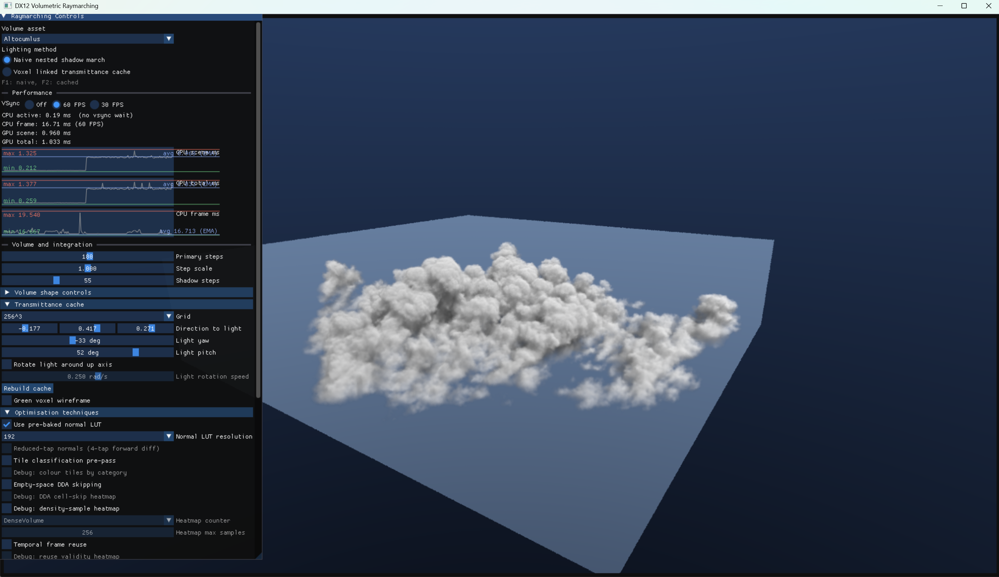
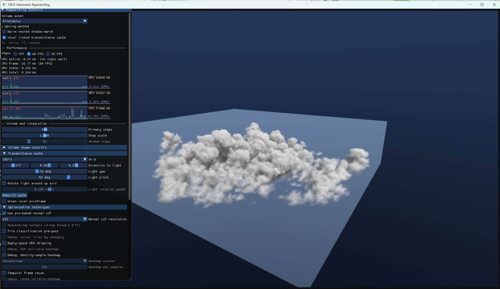
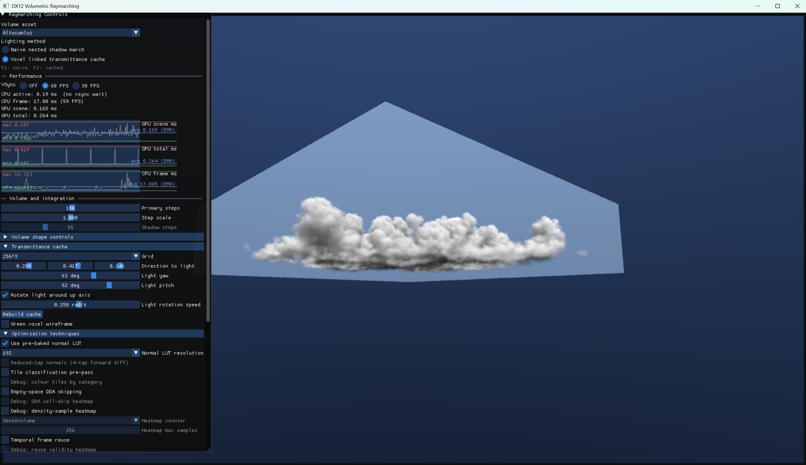
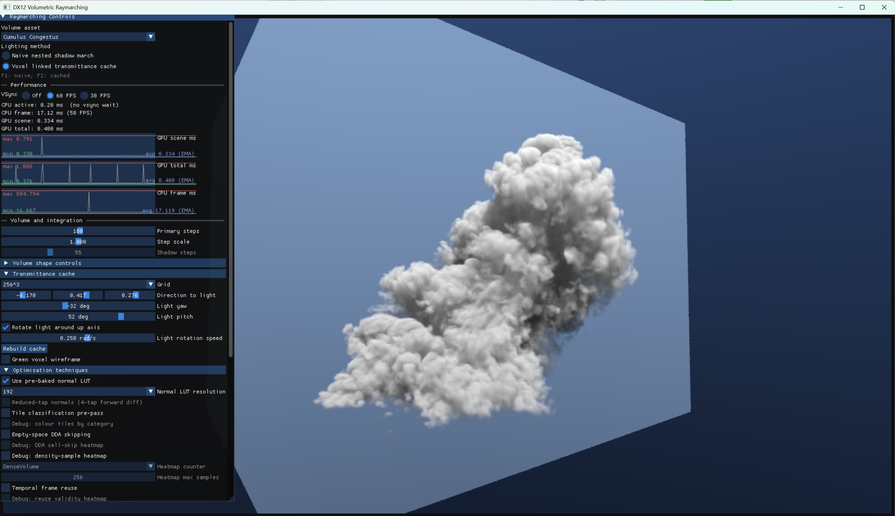
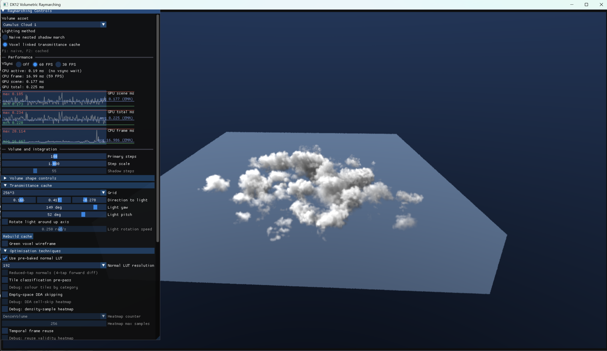

# DX12 Raymarching Optimisation Experiments

This is my learning project for **NVIDIA Nsight Graphics**: build a volumetric raymarcher, use the profiler's bottleneck views to understand where GPU time goes, and measure whether each optimisation actually helps. The goal is to learn the profiling process, not just collect rendering tricks.

The application is a Windows C++/DirectX 12 compute renderer using DXC, OpenVDB cloud assets and Dear ImGui. It compares a naive nested shadow raymarch with a precomputed light-space optical-depth cache, with interactive camera, lighting, density and optimisation controls.

## Profile first, then optimise

The loop is: capture the same workload in Nsight Graphics, inspect the GPU event timings and bottom-up shader/source views, identify the limiting dependency, change one thing, then compare timing and image quality. DXC embeds shader debug information in optimised builds; PIX markers separate cache construction, raymarching and UI work.

Early captures pointed at repeated shadow marches and density-remapping arithmetic. Once those were removed, the bottleneck moved to texture-fetch dependencies and register pressure limiting occupancy. That distinction matters: fewer instructions, samples or registers do not automatically mean a faster shader. In-app timestamp graphs show raw frame spikes and min/max alongside an exponential moving average (EMA); automated image comparisons help catch quality regressions. Interactive close-ups still matter because a sky-heavy benchmark can hide a regression.

## Approaches that worked

| Optimisation | What changed |
| --- | --- |
| Light-aligned optical-depth cache | Integrate density toward the directional light once per cache cell instead of repeating a shadow march at every camera-ray sample. One wave owns a column and uses `WavePrefixSum` to build cumulative optical depth. |
| Dense, hardware-filtered FP16 cache | Replace pointer/metadata-heavy sparse residual lookups with an `R16_FLOAT` 3D texture. A filtered lookup plus `exp(-depth)` supplies lighting without a local correction march. |
| Baked density transfer and occupancy | Bake threshold/gamma remapping instead of repeating it in the hot loop. A conservatively pooled, filtered occupancy mip supports empty-space skipping. |
| Pre-baked normal LUT | Replace repeated finite-difference texture taps with a filtered gradient lookup. Keep normals for the cloud detail rather than removing them purely for speed. |
| Pipelined density fetches and lazy lighting | Fetch the next sample while processing current lighting, and avoid expensive lighting work when its contribution is negligible. Prefetch improved one interactive comparison from roughly 0.15 to 0.13 ms despite using more registers. |
| Specialised shader PSOs | Compile out unused normal, LUT, distance-field and debug paths. Sub-Nyquist-off variants also remove the second cache's normal taps and blending instead of retaining a runtime branch. |
| Sub-Nyquist light-cache updates | For rotating light, build cache poses less frequently and interpolate between them. Matching normal LUTs are baked with the poses; enabling either feature immediately populates valid current/next data. This reduces update frequency, not the cost of an individual rebuild. |

The original linked-cell idea evolved into light-aligned columns: each cell's successor is simply the next cell toward the light. The current dense prefix texture deliberately trades storage for simpler, cheaper sampling. Both rendering modes share the primary density field and shading; the main difference is how they obtain light transmittance.

## Measured performance

**RTX 4090, Release build, 1600 x 900**, `Altocumlus.vdb`, the default reference camera, 180 primary steps and 55 shadow steps. Both modes use the same static light and appearance settings. Results below are median GPU scene-pass times over 300 samples after 1,000 warm-up frames per mode. The capture helper waits for GPU completion between frames to avoid reusing shared descriptors while the cache is being written.

| Mode | GPU scene time | Delta vs naive | Speedup |
| --- | ---: | ---: | ---: |
| Naive nested shadow march | 0.670 ms | -- | 1.0x |
| Fully optimised static-cache path | 0.098 ms | -0.572 ms / -85.3% | 6.8x |

The optimised configuration uses a 256-cubed light cache, a 192-cubed normal LUT, density prefetch and the sub-Nyquist-off PSO. Distance-field skipping, tile classification, temporal reuse, split tracing and amortised rebuilding are off; enabling every checkbox is not the fastest configuration.

These are **raymarch timings, not total frame times**: they exclude UI and cache construction. The separately recorded light-cache build cost was approximately **0.558 ms**; rebuilding every frame would substantially reduce the advantage. Sub-Nyquist interpolation is disabled here for an exact-pose comparison. Readbacks from this same workload achieved mean absolute RGB error **0.043/255** between naive and cached output.

## Cloud gallery

Manually captured in the running application, with ImGui controls and performance graphs visible. The wider views expose an existing background tone-mapping discontinuity at the volume bounds.

### Altocumulus: naive vs optimised

The same medium-distance view and static light, using 180 primary steps, 55 naive shadow steps, a 256-cubed cache and a 192-cubed normal LUT.

| Naive nested shadow march | Optimised transmittance cache |
| --- | --- |
|  |  |
| GPU scene: **0.960 ms** | GPU scene: **0.216 ms** |

The displayed scene times show approximately **4.4x faster rendering** with similar cloud shading. These are interactive UI readings for this view, not the fixed-camera benchmark medians above; click either image for the full-resolution comparison.

### Altocumulus: distant view looking up



### Cumulus Congestus: tall cloud structure



### Cumulus Cloud 1



## Experiments that did not pay off

- **Bit-packed, point-sampled occupancy:** saved memory but produced horizontal skip-boundary streaks; reverted to filtered occupancy.
- **Two-level sparse residual cache:** worked, but metadata, unpacking and manual interpolation were more expensive than a dense filtered texture.
- **Tile classification:** reduced sample counts, but pass overhead made the measured gain small or neutral; remains optional.
- **Removing density prefetch / forcing fewer registers:** hurt interactive performance by exposing texture latency.
- **Filtered distance-field reads instead of point loads:** increased register pressure and measured time; reverted.

Triple-buffered progressive cache rebuilding is also implemented, but its spike-reduction benefit is not yet established. It remains experimental rather than part of the measured configuration.

## Build and run

Requires Windows 10/11, Visual Studio 2022 with Desktop C++, CMake 3.24+, Git, vcpkg and a DirectX 12 GPU.

```powershell
$vcpkg = "C:\Program Files (x86)\Microsoft Visual Studio\2022\Enterprise\VC\vcpkg"
cmake -S . -B build-vdb -G "Visual Studio 17 2022" -A x64 `
  -DCMAKE_TOOLCHAIN_FILE="$vcpkg\scripts\buildsystems\vcpkg.cmake" `
  -DVCPKG_INSTALLED_DIR="$PWD\vcpkg_installed"
cmake --build build-vdb --config Release
.\build-vdb\Release\DX12Raymarching.exe
```

The manifest restores OpenVDB dependencies; CMake fetches Dear ImGui and PIX marker support, compiles Shader Model 6.0 shaders with DXC, and copies the VDB assets beside the executable.

Select a cloud in **Volume asset**. **F1/F2** switch naive/cached lighting; left-drag orbits and the wheel dollies. The panel exposes density/lighting controls, optimisation toggles, sample-count heatmaps and CPU/GPU graphs.

For the fixed-camera image/timing regression:

```powershell
cmake --build build-vdb --config Release --target RunCacheParity
```

It writes PPM captures and `report.json` to `cache-test-results` in its working directory. Passing requires mean RGB error at most 1.0/255 and cached scene rendering at least 5% faster. It disables light rotation and temporal cache interpolation so the comparison uses matching poses.

The cache currently targets one directional light. Multiple/local lights and asynchronous compute scheduling are outside this experiment's scope.
